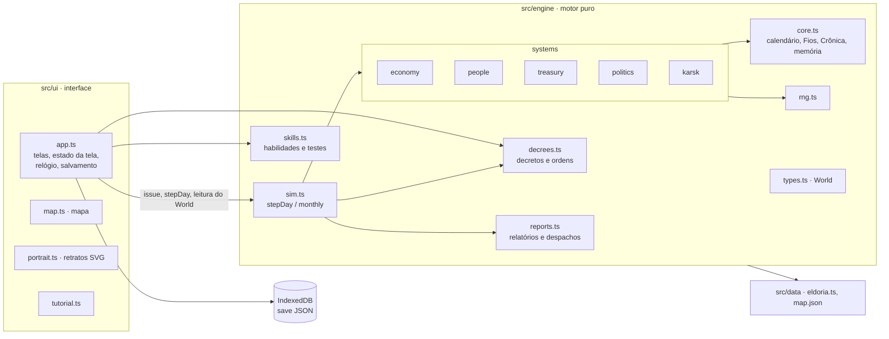
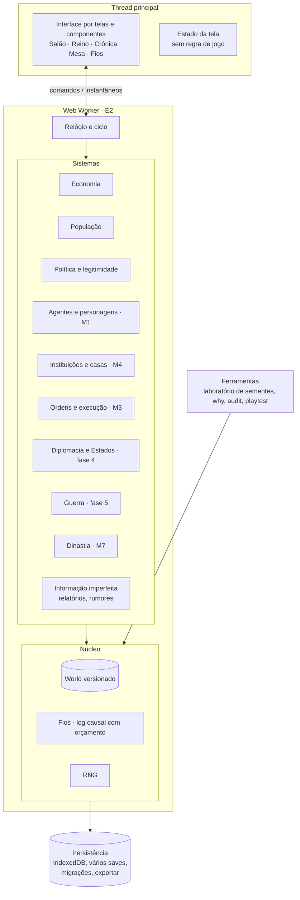

# Arquitetura do IMPERIUM

**Atualizado em 27/11/2026.** A parte "Hoje" descreve o código real. A parte "Alvo" é PROPOSTA técnica (ver ADR-0005 e ADR-0006).

## 1. Princípios (vêm da Memória Mestra §6.1 e §13, CONFIRMADOS)

1. O motor de simulação é separado da interface e testável sem ela.
2. Determinismo: semente + ordens do jogador reproduzem a história exata.
3. O mundo inteiro é um objeto serializável (`World`), inclusive o RNG.
4. Causalidade rastreável: os Fios registram por que cada número mudou.
5. Desempenho sem simulação falsa: agregação e níveis de detalhe são permitidos se preservarem a causalidade.

## 2. Hoje

### Fluxo de um dia (`stepDay`)
1. `processOrders` aplica decretos cujas ordens chegaram à província.
2. `deliverReports` entrega relatórios que terminaram a viagem.
3. `expireDispatches` encerra audiências vencidas (e quem foi ignorado lembra).
4. No último dia do mês, `monthly` roda o ciclo fixo:
   clima → produção → comércio → consumo → preços → demografia → humor → inquietação → guarnições → tesouro → Karsk → povo nacional → legitimidade → efeitos dos degraus → relatórios → despachos → resumo → poda dos Fios.

### Como os sistemas conversam
Por **estado compartilhado no `World`** e pela **ordem fixa do ciclo**. Cada sistema lê o que os anteriores escreveram no mesmo mês. Isso é simples, determinístico e rápido, mas as dependências ficam implícitas: só a ordem em `sim.ts` diz quem depende de quem.

### Pontos fortes do que existe
- Motor puro, sem DOM, sem relógio real, sem `Math.random` (verificado em 27/11/2026).
- Determinismo coberto por teste (2 e 10 anos) e salvar/carregar no meio sem mudar o futuro.
- Fios já ligam decretos a efeitos em cadeia (imposto → humor → inquietação).
- Rápido: 10 anos de jogo em menos de 0,5 s em servidor.

### Fragilidades (honestas)
- `app.ts` concentra telas, estado da interface, relógio e salvamento em 765 linhas.
- Save sem migração (`version: 1` e checagem de igualdade); um campo novo quebra saves antigos ou precisa de remendo (`skills?` já é um remendo).
- O save cresce sem limite (~500 KB por ano de jogo).
- Dependências entre sistemas implícitas na ordem do ciclo.
- Textos de interface montados dentro do motor (ex.: a Crônica), com formatação de número que depende do ambiente.
- Não há agentes individuais; a estrutura de dados atual não tem lugar para personagens.

## 3. Alvo (PROPOSTA)

### Regras de dependência (valem desde já)
- `src/engine/**` não importa de `src/ui/**` nem de `tools/**`.
- `src/data/**` não importa de lugar nenhum além de tipos.
- Um sistema não chama outro sistema diretamente: lê e escreve o `World`. A ordem do ciclo em `sim.ts` é o único lugar que define quem roda antes de quem. Toda dependência nova entre sistemas é registrada na spec do sistema (`docs/systems/`).
- A interface só muda o mundo por comandos (`issue`, `runCheck`), nunca escrevendo no `World` direto. Isso mantém o registro de ordens (`World.log`) suficiente para reproduzir uma partida.

### Separação por domínio (onde cada coisa vai morar)
| Domínio | Hoje | Alvo |
|---|---|---|
| Núcleo (tempo, RNG, Fios, Crônica) | `core.ts`, `rng.ts`, `sim.ts` | `engine/core/` |
| Estado do mundo | `types.ts`, `world.ts` | `engine/state/` com versão e migrações |
| Agentes e personagens | — | `engine/agents/` |
| Economia | `systems/economy.ts` | `engine/systems/economy/` |
| População | `systems/people.ts` | `engine/systems/population/` |
| Política e instituições | `systems/politics.ts` | `engine/systems/politics/` |
| Diplomacia | `systems/karsk.ts` | `engine/systems/diplomacy/` |
| Guerra | parte de `karsk.ts` e guarnições | `engine/systems/war/` |
| Dinastia e relações | — | `engine/systems/dynasty/` |
| Interface | `ui/app.ts` | `ui/screens/`, `ui/components/` |
| Persistência | dentro de `ui/app.ts` | `persistence/` (fora do motor, fora da tela) |
| Depuração | `tools/*.ts` | `tools/lab/` |

A mudança de pastas acontece **aos poucos**, quando cada módulo for tocado por uma tarefa real, nunca numa reorganização grande e isolada.
