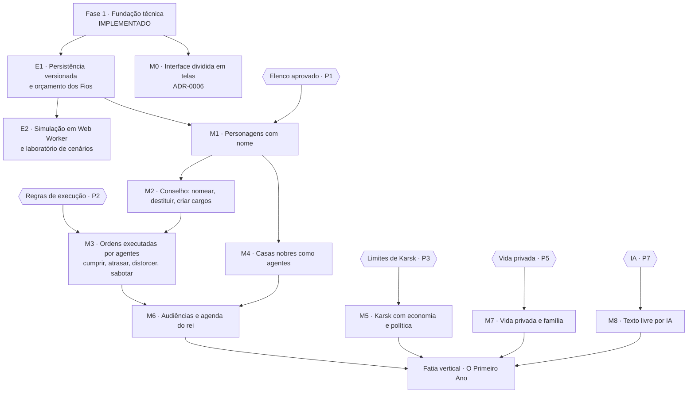

# Roadmap

**Atualizado em 27/11/2026.** Baseado nas fases da Memória Mestra §14.2 (PROPOSTA) e no escopo CONFIRMADO da fatia vertical (D2: só Eldoria, "O Primeiro Ano"). Cada etapa só começa quando as regras dela estiverem aprovadas (ver `PENDENCIAS.md`). Etapas de engenharia pura (E) não dependem de design e podem andar em paralelo.

Estados: ver `CLAUDE.md` §4.

## Visão geral

## Etapas

| # | Etapa | Depende de | Regras | Estado |
|---|---|---|---|---|
| F1 | **Fundação técnica** (motor, tempo, sementes, Fios, economia, povo, tesouro, legitimidade, Karsk, decretos, relatórios, habilidades, interface, PWA) | Memória Mestra v1.5 | Estrutura CONFIRMADA; números PROPOSTA | IMPLEMENTADO (ver ESTADO) |
| E0 | **Estrutura profissional** (CLAUDE.md, skills, agentes, docs, CI, testes de longa duração) | — | Técnico | EM DESENVOLVIMENTO (este PR) |
| E1 | **Persistência versionada e orçamento dos Fios**: número de versão do save com migrações, salvamento em vários espaços, limite de tamanho dos Fios sem quebrar cadeias, teste de 30 anos | — | Técnico | PENDENTE · **primeiro módulo recomendado** |
| E2 | **Simulação em Web Worker e laboratório de cenários**: a interface não trava enquanto o mundo anda; ferramenta para rodar N sementes, comparar e explicar resultados pelos Fios | E1 | Técnico | PENDENTE |
| M0 | **Interface dividida em telas** (`app.ts` em módulos), sem mudar o que o jogador vê | — | Técnico | PENDENTE |
| C1 | **Correções de integridade que dependem de design**: limite das tropas de Karsk, atraso de soldo por soldado, guarnição que se recupera | P3 | Design | BLOQUEADO (aguarda P3) |
| M1 | **Personagens com nome** (nível 1 de agentes: traços, memória, objetivos, relações, segredos) | P1, E1 | PENDENTE | BLOQUEADO |
| M2 | **Conselho**: ocupantes, nomear, destituir, criar e extinguir cargos | M1 | Cargos CONFIRMADOS; resto PENDENTE | BLOQUEADO |
| M3 | **Ordens executadas por agentes** ("ordenar não é ser obedecido") | M2, P2 | PROPOSTA | BLOQUEADO |
| M4 | **Casas nobres como agentes** (chefes, recursos, objetivos, conspiração com rosto) | M1 | PROPOSTA (Memória Mestra §10.1) | BLOQUEADO |
| M5 | **Karsk com economia e política próprias** | P3 | PENDENTE | BLOQUEADO |
| M6 | **Audiências e agenda do rei** (o tempo do rei como recurso escasso) | M3, M4 | PROPOSTA (§3.1) | BLOQUEADO |
| M7 | **Vida privada e família** | P5 | PENDENTE | BLOQUEADO |
| M8 | **Texto livre por IA** convertido em decreto estruturado | P7 | CONFIRMADO como extra (D3) | BLOQUEADO |
| V | **Fatia vertical "O Primeiro Ano"**: critério de aceitação da Memória Mestra §14.1 (partida de 2 a 4 horas com uma cadeia longa sem roteiro, explicável pelos Fios) | M1 a M8 | Escopo CONFIRMADO (D2) | PENDENTE |
| Fases 3 a 8 | Reino inteiro, vizinhos, guerra, gerações, continente, polimento | V | PROPOSTA (§14.2) | PENDENTE |

## Regra de priorização

1. Integridade e continuidade antes de conteúdo (E1 antes de M1), porque saves quebrados e Fios perdidos destroem a confiança na simulação.
2. Personagens antes de mais números: o maior buraco entre a visão e o código é a ausência de agentes com rosto.
3. Nada entra se não afetar outro sistema e não puder ser explicado pelos Fios.
