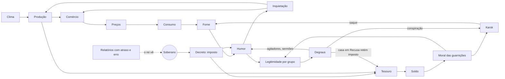

# Especificações dos sistemas

Uma especificação por sistema, sempre no mesmo molde (`_MODELO.md`). Elas descrevem **o que o código faz hoje** e o que falta, separando o que é CONFIRMADO, PROPOSTA e PENDENTE. Os números exatos das fórmulas implementadas estão em `docs/design/ESPEC_FUNDACAO.md` §4 e §5 e no próprio código; aqui ficam as regras, as ligações e os critérios.

Antes de implementar ou mudar um sistema, a spec dele precisa ter as 10 partes preenchidas (Diretriz Mestra §9). Se faltar regra, registre a lacuna em `docs/development/PENDENCIAS.md` e peça validação ao Tales; não invente.

| Sistema | Arquivo | Regras | Código |
|---|---|---|---|
| Tempo e ciclo | [tempo.md](tempo.md) | CONFIRMADO (D4) | IMPLEMENTADO, TESTADO |
| Os Fios e a Crônica | [fios.md](fios.md) | PROPOSTA | IMPLEMENTADO, TESTADO |
| Economia | [economia.md](economia.md) | PROPOSTA | IMPLEMENTADO, parcialmente testado |
| População, humor e ordem | [populacao.md](populacao.md) | PROPOSTA | IMPLEMENTADO, parcialmente testado |
| Tesouro e guarnições | [tesouro-e-guarnicoes.md](tesouro-e-guarnicoes.md) | PROPOSTA | IMPLEMENTADO, TESTADO |
| Legitimidade | [legitimidade.md](legitimidade.md) | Direção CONFIRMADA (D9); números PROPOSTA | IMPLEMENTADO, parcialmente testado |
| Karsk | [karsk.md](karsk.md) | PROPOSTA | IMPLEMENTADO, com problemas |
| Decretos e ordens | [decretos.md](decretos.md) | Base CONFIRMADA (D3) | IMPLEMENTADO, TESTADO |
| Informação: relatórios e audiências | [informacao.md](informacao.md) | PROPOSTA | IMPLEMENTADO |
| Habilidades do soberano | [habilidades.md](habilidades.md) | Nomes e testes CONFIRMADOS | IMPLEMENTADO, TESTADO |
| Personagens e agentes | [personagens.md](personagens.md) | PENDENTE | Não existe |
| Sistemas futuros (dinastia, diplomacia, guerra, religião, IA) | [futuros.md](futuros.md) | PENDENTE | Não existe |

## Mapa das ligações (hoje)

